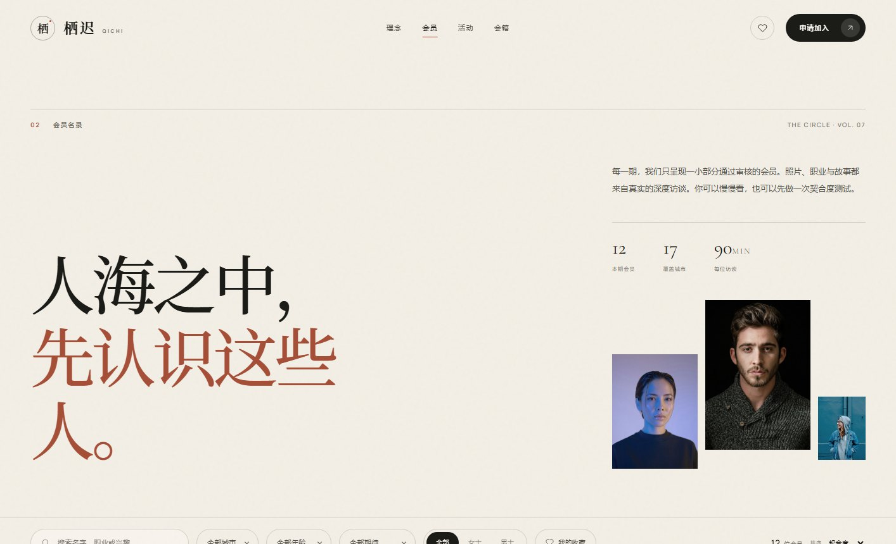
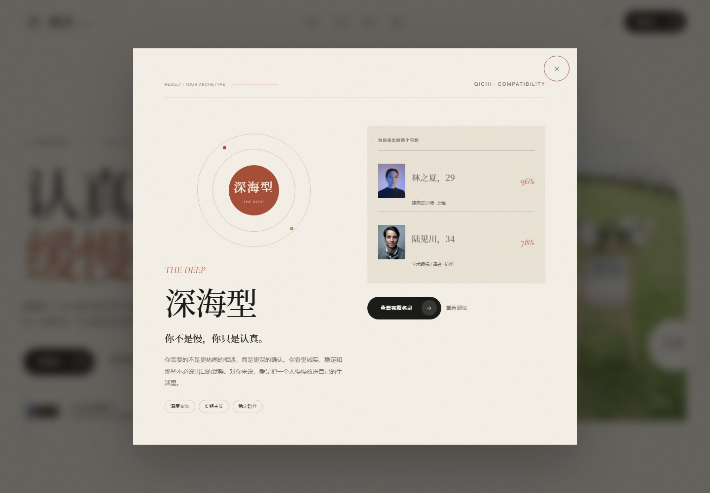

# 栖迟 QICHI

> 认真遇见，缓慢相爱。

一个为「认真关系」而生的高端婚恋俱乐部网站 Demo。以编辑杂志式的版式、克制的动效和完整的前端交互，呈现一个可以被真实使用的产品原型。

**[在线预览 →](https://samyihu.github.io/qichi/)**


| 会员名录 | 契合度测试 |
| --- | --- |
|  |  |

## 设计概念

栖迟（Qī Chí）取自《诗经》「衡门之下，可以栖迟」。它不是左滑右滑的速配产品，而是一个小型、私密、以面对面访谈为起点的婚恋俱乐部。

视觉上采用 **Quiet Luxury / Editorial** 方向：

- 米纸色、墨色与陶土红的低饱和色板
- Noto Serif SC 的中文宋体骨架，搭配 Cormorant Garamond 的英文意大利体
- 大量留白、非对称构图、竖排细节与纸张颗粒
- 克制的进入动效、图片裁切和悬停反馈，不使用浮夸的渐变与卡片阴影

## 已实现功能

- **品牌首页**：全屏 Hero、品牌叙事、本周引荐、服务流程、活动、真实故事轮播、会籍 CTA
- **会员名录**：12 份虚构会员档案；城市 / 年龄 / 性别 / 关系期待筛选、关键词搜索、契合度 / 加入时间 / 年龄排序
- **会员档案**：档案弹窗、生活方式与关系观、兴趣标签、基于偏好计算的契合度、收藏与「送出心动」
- **契合度测试**：5 个问题、3 种关系原型、即时结果、匹配推荐
- **会籍申请**：三步骤表单、逐步校验、意向会籍预选、提交后生成申请编号
- **活动预约**：活动详情与席位预约弹窗，预约状态本地保存
- **个人状态**：收藏、心动、申请与订阅均通过 `localStorage` 持久化，刷新后仍然保留
- **响应式**：360 / 390 / 768 / 1024 / 1440 宽度下无横向溢出；移动端有全屏菜单与底部弹窗
- **无障碍基础**：语义化标题、键盘可操作的会员卡片、模态框焦点陷阱、Esc 关闭、减少动效偏好支持

> 所有会员、活动、故事与价格均为演示内容。申请表单不会向服务器发送数据，所有状态只保存在当前浏览器。

## 技术栈

- 原生 HTML / CSS / JavaScript（ES Modules）
- 无构建步骤、无运行时依赖，直接部署静态文件
- 自托管字体（Noto Serif SC 子集 + Cormorant Garamond + Manrope）
- GitHub Actions → GitHub Pages

## 本地运行

任选一种：

```bash
# 零依赖静态服务器
node server.mjs
```

```bash
# 或者
python -m http.server 4173
```

打开 `http://127.0.0.1:4173/`。

## 部署

仓库已包含 `.github/workflows/deploy.yml`。推送到 `main` 后，Actions 会自动构建并发布到 GitHub Pages。

首次使用时，如果仓库尚未启用 Pages，workflow 中的 `actions/configure-pages` 会尝试自动启用；也可以在 **Settings → Pages** 中将 Source 设为 **GitHub Actions**。

## 项目结构

```text
.
├── index.html
├── assets/
│   ├── css/style.css
│   ├── js/app.js
│   ├── js/data.js
│   ├── fonts/
│   └── images/
├── screenshots/
├── server.mjs
├── .github/workflows/deploy.yml
└── package.json
```

## 影像与字体

摄影来自 [Unsplash](https://unsplash.com)，仅用于设计演示。字体许可如下：

- **Noto Serif SC** — SIL Open Font License 1.1
- **Cormorant Garamond** — SIL Open Font License 1.1
- **Manrope** — SIL Open Font License 1.1

## License

代码以 MIT License 发布；摄影与字体遵循各自的原始许可。
